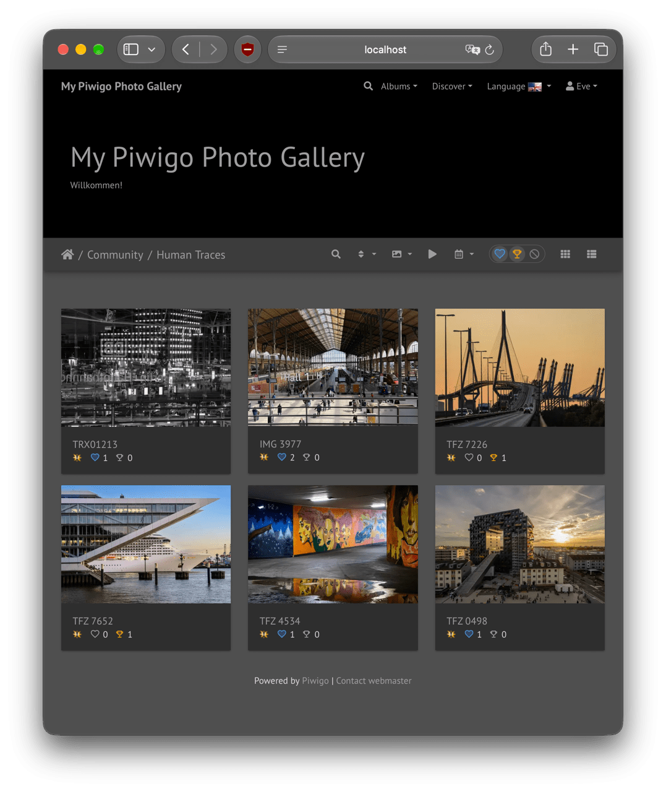

# Like & Bravo

A plugin for [Piwigo](https://piwigo.org) 16 that replaces the star rating by
"Like", or by "Like" and "Bravo", in the albums you choose. Other albums keep
their stars, or have no rating at all.

It is built on Piwigo's own rating system: votes are stored as ordinary ratings,
"Best rated" keeps working, and an album can be switched between stars and likes
at any time without losing a vote.

* Internal name: `like_bravo` (directory name in `plugins/`)
* Requires Piwigo 16 or later, PHP 8
* Languages: English, German, French, Spanish, Italian

## What visitors get

On the photo page of an album in a like mode, the stars are replaced by a small
widget:

* one button for "Like" and, if the album allows it, one for "Bravo";
* counters such as "12 likes · 3 bravos" instead of a score;
* a click on the active button takes the vote back. There is no "dislike".

Members can see who voted. Hovering over a counter shows a short form ("Liked by
Anna, Ben, Carl and 4 others"), a click on it shows all names.


A click on a counter lists everybody who voted:


The widget takes its colours from the theme. This is the theme Modus:


On album pages, the thumbnails of these photos show the same icons with the
number of likes and bravos, next to the theme's icon for new photos. A click on an
icon votes or takes the vote back, as on the photo page; the names of the voters
are only on the photo page. The theme Modus, with its justified rows, shows them
as a small badge in the corner of the photo.

In Bootstrap Darkroom the icons sit in the caption, next to the star that marks
new photos:



In Modus they are a badge in the top right corner of each photo:


Signed-in members also find three icons in the toolbar of album pages, to filter
the photos by their own votes: the photos they liked, those they gave a bravo, and
all others. The icons can be combined, and the page shows the photos of every
active group. No active icon, or all three, shows all photos. The filter stays on
for the session, like the sort order, and also applies to "previous" and "next"
on the photo page. Photos with stars or without rating count as "all others".

The three icons share a frame, so they read as one group among the theme's own
buttons. Active icons are filled in their colour on a grey background. Here the
filter shows the photos liked or given a bravo, without "all others":


In the collapsed menu of narrow windows, the group sits on one line headed
"Filter". Hovering over an icon shows what it filters.

The menu block "Explore" gets two personal pages for signed-in members: "My likes"
and "My bravos", with the latest votes first.

## Requirements

* "Allow rating" must be switched on in the Piwigo configuration.
* The rating values 2 and 4 must be available. They are with Piwigo's default
  values (0 to 5); this only matters if you changed `$conf['rate_items']`.

## Installation

1. Unpack the archive into the `plugins` directory of your gallery. The folder
   must be named `like_bravo`.
2. In the administration, open Plugins and activate "Like & Bravo".

## Choosing the albums

Open an album in the administration and go to the tab "Member rating". Each album
has one of five settings:

| Setting | Effect |
|---|---|
| Inherited (default) | the setting of the nearest parent album that has one; Piwigo's stars if none has |
| Piwigo stars | Piwigo's stars, also if a parent album says otherwise |
| No rating | no stars, no buttons, no score; the photos are left out of "Best rated" |
| Like only | the "Like" button |
| Like + Bravo | the "Like" and the "Bravo" button |


A setting applies to the album and all its sub-albums until a sub-album has its
own. A photo that belongs to several albums follows the setting that allows the
most rating: Like + Bravo before Like only before Piwigo stars before No rating.
Albums without any setting, of their own or inherited, count least: a photo in an
album without rating and in an album without any setting has no rating.

"No rating" needs no change to the Piwigo configuration: "Allow rating" stays on
for the rest of the gallery.

## Settings

Under Plugins, "Like & Bravo" has a settings page:

* **Icons** for Like, Bravo and "Remove my vote", from a built-in set.
* **Place of the widget**: right below the photo, as a compact line without
  heading (default), or with the photo information. Below the photo works in the
  theme Bootstrap Darkroom for now; other themes always show the widget with the
  photo information.
* **Likes and bravos below the thumbnails** (on by default). They need the
  captions below the thumbnails, which Piwigo and some themes can switch off;
  Modus with justified rows shows them as a badge on the photo instead.
* **Members may rate their own photos** (on by default).
* **Guests may like** (off by default). It needs Piwigo's own option "Rating by
  guests". Piwigo tells guests apart by their network address only, so guest votes
  are neither exact nor safe from manipulation; the settings page explains the
  details.
* **Names of voters**: shown to nobody, to signed-in members (default) or to all
  visitors, and how many names the short form holds. Switching this on also shows
  the names for votes cast earlier. Guests never have a name, they appear as a
  number.


## Changing the texts

Every text of the plugin can be changed per language in
`local/language/<code>.lang.php`, for example with the plugin LocalFilesEditor:

```php
$lang['Member rating'] = 'Club rating';
$lang['Bravo'] = 'Award';
$lang['%d bravo'] = '%d award';
$lang['%d bravos'] = '%d awards';
```

The keys are the English texts in `language/en_UK/plugin.lang.php`.

## How the score is computed

A like is worth 2 points and a bravo 4 points. The score of a photo compares its
points with the average of all liked photos in the gallery, on Piwigo's scale from
0 to 5: a photo with average points scores 2.5, one with four times the average
4.0. Photos with stars keep Piwigo's own score.

The full rule, with the formula, examples and what happens when an album is
switched, is in [docs/rating.md](docs/rating.md).

## Deactivating and uninstalling

* **Deactivating** hands all scores back to Piwigo. Likes then count as a rating
  of 2 and bravos as a rating of 4. The album settings are kept, and activating
  the plugin again restores the like scores.
* **Uninstalling** also removes the album settings and the plugin configuration.
  The votes stay in Piwigo's rating table.

## Known limitations

* Piwigo does not tell plugins when a photo is moved or added to another album.
  The score of such a photo follows with the next vote anywhere in the gallery or
  the next change of an album setting.
* The theme SmartPocket shows a fixed list of entries in its menu. "My likes" and
  "My bravos" are missing there; the pages themselves work. Its thumbnails have
  no caption and no toolbar, so they show no likes and bravos and there is no
  filter.
* Without captions below the thumbnails there are no likes and bravos on them,
  for example in Modus with square thumbnails, where the theme switches the
  captions off. Votes are then given on the photo page.
* The French, Spanish and Italian texts have not been reviewed by native
  speakers. Corrections are welcome.

The photo page has been tested with the themes Bootstrap Darkroom, Modus, Elegant
and SmartPocket. Thumbnails loaded later while scrolling, for example by the
plugin RV Thumb Scroller, get their likes and bravos as well.

## License

Copyright (C) 2026 Tilmann Haeberle

This program is free software; you can redistribute it and/or modify it under the
terms of the GNU General Public License as published by the Free Software
Foundation; either version 2 of the License, or (at your option) any later
version. See [LICENSE](LICENSE).
